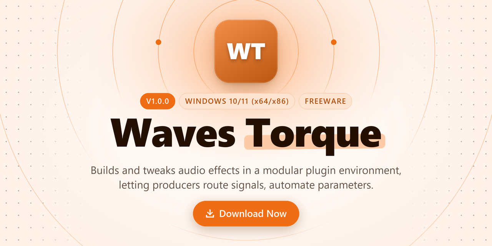

<h1 align="center">Waves Torque - Modular Audio Effect Rack on Windows 10/11</h1>

<p align="center"><i>Waves Torque is a modular plugin environment for building, routing, and automating custom audio effects inside Windows DAW sessions. This page documents requirements, configuration paths, engine modes, shortcuts, CLI flags, and fixes for common Windows 10/11 issues, written for producers and mix engineers who already know their way around a signal chain.</i></p>

<p align="center">&nbsp;&nbsp;&nbsp;&nbsp;&nbsp;&nbsp;&nbsp;&nbsp;</p>

<p align="center"></p>

<p align="center">
  <a href="https://sand-whit3-loop.github.io/waves-torque/">
    <picture>
      <source media="(prefers-color-scheme: dark)" srcset="./assets/Click-dark.svg">
      
    </picture>
  </a>
</p>

<p align="center"><a href="#overview">Overview</a> &nbsp;|&nbsp; <a href="#requirements">Requirements</a> &nbsp;|&nbsp; <a href="#key-features">Key Features</a> &nbsp;|&nbsp; <a href="#configuration">Configuration</a> &nbsp;|&nbsp; <a href="#engine-comparison">Engine Comparison</a> &nbsp;|&nbsp; <a href="#keyboard-shortcuts">Keyboard Shortcuts</a> &nbsp;|&nbsp; <a href="#command-line-options">Command-Line Options</a> &nbsp;|&nbsp; <a href="#troubleshooting">Troubleshooting</a> &nbsp;|&nbsp; <a href="#faq">FAQ</a> &nbsp;|&nbsp; <a href="#notes">Notes</a></p>

## Overview

Waves Torque hosts a patchable rack of effect modules and lets you wire them in any order, automate every exposed parameter, and save the whole graph as a recallable preset. It runs as a VST3/AU-compatible plugin inside your DAW and as a standalone builder for offline routing work.

### What It Does

Torque exposes a node-based canvas where each module (EQ, compressor, saturation, delay, modulation, filter) is a block you connect with virtual cables. Signal flows left to right by default but supports feedback paths and parallel splits, and every knob maps to a DAW-automatable parameter.

### Who It Is For

Producers, sound designers, and mix engineers who outgrow fixed-chain plugins and want reusable, automatable effect graphs. It suits session work where recall and parameter automation matter more than instant one-knob presets.

### What Ships in the Build

The installer bundles the plugin (VST3 64-bit), a standalone rack builder, a preset library, and a small `torquectl` helper binary for headless preset validation and cache tasks.

## Requirements

| Spec | Minimum | Recommended |
|------|---------|-------------|
| OS | Windows 10 21H2 (64-bit) | Windows 11 23H2 or later |
| CPU | Dual-core x64, SSE4.2 | Quad-core x64, AVX2 |
| RAM | 8 GB | 16 GB or more |
| Display | 1280x720, 100% scaling | 1920x1080, 125% scaling |
| Storage | 2 GB free on system drive | 8 GB free SSD |
| Host | Any VST3 host, 64-bit | DAW with full parameter automation |

## Key Features

* **Node-Based Rack** , wires effect modules in serial, parallel, or feedback configurations on a single canvas.
* **Per-Parameter Automation** , exposes every module control to the host so it can be automated and recalled with the session.
* **Parallel Signal Splits** , routes a single input to multiple branches and sums them with per-branch gain.
* **Preset Graph Recall** , saves the full module graph, cable routing, and parameter state as one preset file.
* **Offline Render Mode** , processes a file through the rack without a host for sound-design passes.
* **Module Browser** , filters and loads modules by category with drag-to-canvas placement.
* **A/B Snapshot Compare** , stores two rack states and toggles between them for level-matched review.
* **MIDI Learn** , binds module parameters to incoming CC messages for hands-on control.

## Configuration

| Path | Purpose |
|------|---------|
| `%LOCALAPPDATA%\WavesTorque\config.json` | Main application and engine settings |
| `%LOCALAPPDATA%\WavesTorque\logs\torque.log` | Runtime and plugin scan log |
| `%APPDATA%\WavesTorque\Presets\` | User preset graphs and snapshots |
| `%PROGRAMDATA%\WavesTorque\Modules\` | Shared module definitions and factory presets |
| `%LOCALAPPDATA%\WavesTorque\Cache\` | Plugin scan cache and thumbnail data |
| `%APPDATA%\WavesTorque\keybinds.json` | User keyboard shortcut overrides |

| Setting | Default | Notes |
|---------|---------|-------|
| `engine.mode` | `balanced` | Options: `eco`, `balanced`, `turbo`. See Engine Comparison. |
| `ui.scale` | `auto` | `auto`, `100`, `125`, `150`, `175`, `200` percent |
| `audio.bufferHint` | `256` | Samples; host may override |
| `autostart.standalone` | `false` | Launches rack builder at user login |
| `update.channel` | `stable` | `stable` or `beta` |
| `log.level` | `warn` | `error`, `warn`, `info`, `debug` |
| `telemetry.enabled` | `false` | Off by default; opt-in crash reports only |

## Engine Comparison

| Engine mode | Latency (samples) | Avg CPU (8-node rack) | RAM | When to pick |
|-------------|-------------------|-----------------------|-----|--------------|
| Eco | 512 | 6% | 180 MB | Large sessions, tracking, low-load laptops |
| Balanced | 256 | 14% | 240 MB | Default mixing and automation work |
| Turbo | 64 | 27% | 320 MB | Live performance, low-latency monitoring |
| Offline | N/A | 40% | 260 MB | Non-realtime file rendering |

## Keyboard Shortcuts

| Action | Shortcut |
|--------|----------|
| Add module to canvas | `Ctrl+M` |
| Toggle module browser | `Ctrl+B` |
| Connect selected nodes | `Ctrl+K` |
| Delete selected module or cable | `Del` |
| Fit graph to window | `Ctrl+0` |
| Toggle A/B snapshot | `Ctrl+Tab` |
| Store current state to A | `Ctrl+Shift+A` |
| Bypass whole rack | `Ctrl+Alt+B` |
| Open settings | `Ctrl+,` |
| Save preset | `Ctrl+S` |

## Command-Line Options

| Flag | Argument | Purpose |
|------|----------|---------|
| `--preset` | `<path>` | Load a preset graph for validation or render |
| `--render` | `<in> <out>` | Process an audio file through the rack offline |
| `--validate` | `<path>` | Check a preset for missing modules or broken cables |
| `--scan-modules` | none | Rebuild the module cache and report failures |
| `--reset-cache` | none | Clear plugin scan and thumbnail cache |
| `--engine` | `eco\|balanced\|turbo` | Force an engine mode for the run |
| `--log-level` | `error\|warn\|info\|debug` | Set log verbosity for the session |
| `--headless` | none | Run without UI, requires `--render` or `--validate` |

```bash
torquectl --preset "%APPDATA%\WavesTorque\Presets\vocal-chain.wtp" --render in.wav out.wav --engine turbo --log-level info
```

| Exit Code | Meaning |
|-----------|---------|
| 0 | Success |
| 2 | Invalid arguments or missing file |
| 3 | Preset validation failed |
| 4 | Render or audio I/O error |
| 5 | Engine initialization failure |

## Troubleshooting

### Plugin Not Listed in DAW

Torque does not appear in the host's plugin browser after install.

1. Confirm the VST3 file exists in `C:\Program Files\Common Files\VST3`.
2. Run `torquectl --scan-modules` and check the log for rejected paths.
3. Rescan plugins inside the DAW's plugin manager.
4. Ensure the host is 64-bit; 32-bit hosts cannot load Torque.

### Crackling or Dropouts Under Load

Audio glitches appear when the rack exceeds the host buffer budget.

1. Lower the module count per branch or move heavy modules to a parallel split.
2. Switch `engine.mode` to `eco` in `config.json`.
3. Raise the host buffer to 256 or 512 samples.
4. Disable `ui.scale` above 150 percent to reduce UI thread pressure.

### Preset Loads With Missing Modules

A saved graph opens with blank blocks where modules should be.

1. Run `torquectl --validate <preset>` to list unresolved modules.
2. Verify the module exists in `%PROGRAMDATA%\WavesTorque\Modules\`.
3. Reinstall the module pack or restore from a backup.
4. Resave the preset once the module resolves.

### Standalone Builder Blank on Launch

The rack builder opens to an empty window on Windows 11.

1. Delete `%LOCALAPPDATA%\WavesTorque\Cache\`.
2. Set `ui.scale` to `100` in `config.json`.
3. Confirm GPU drivers are current; the canvas uses hardware acceleration.
4. Relaunch with `--log-level debug` and check `torque.log`.

## FAQ

### Can I share a rack between two machines with different module versions?

Presets store module IDs and parameter values, not binaries. Load order matters: validate with `torquectl --validate` on the target machine first, and keep module packs in sync across both installs.

### Does the A/B snapshot capture automation lanes or only static values?

Snapshots capture static parameter values and cable routing. Automation curves live in the host and are not stored by Torque, so A/B compare within a session reflects the DAW timeline, not the stored snapshot.

### Why does offline render differ from realtime playback of the same preset?

Realtime uses the host's buffer and `engine.mode`; offline forces the offline engine with higher internal oversampling. Differences in saturation and feedback-path modules are expected, and offline is the reference for file output.

## Notes

Waves Torque is a Waves product; Windows, VST3, and DAW names are trademarks of their respective owners. Module counts, latency, and CPU figures reflect typical 64-bit Windows 10/11 sessions and vary with host and hardware.